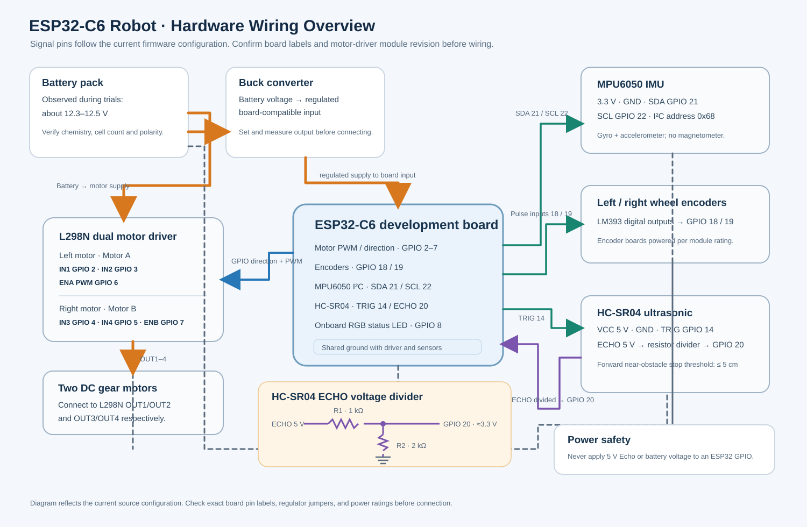

# Technical Notes

This document describes the implementation that is currently in this repository. It distinguishes implemented behavior from goals that remain unvalidated.

## System layout

The firmware follows a layered ESP-IDF design:

- **HAL** configures and accesses GPIO, PWM, encoders, the MPU6050, the ultrasonic sensor, and the status LED.
- **Services** provide Wi-Fi, UDP, OTA, and pose/odometry functions.
- **Application orchestrator** initializes the services, runs periodic tasks, handles the movement commands, and publishes telemetry.
- **Laptop tools** receive and display telemetry (`server.py`) and expose short movement taps to a phone browser (`web_controller.py`).

The ground station is the operator's display and calibration/OTA tool. The phone page is only a four-direction tap controller. Waypoints are saved as visual laptop references; no waypoint navigation algorithm is implemented.

## Wiring and power



| Part | ESP32-C6 connection | Notes |
| --- | --- | --- |
| L298N left motor direction A/B | GPIO 2 / GPIO 3 | IN1 / IN2 |
| L298N right motor direction A/B | GPIO 4 / GPIO 5 | IN3 / IN4 |
| L298N left/right PWM enables | GPIO 6 / GPIO 7 | ENA / ENB, 5 kHz LEDC PWM |
| Left/right LM393 encoder outputs | GPIO 18 / GPIO 19 | Interrupt-driven pulse inputs |
| HC-SR04 Trigger / Echo | GPIO 14 / GPIO 20 | Echo goes through the 1 kΩ / 2 kΩ divider described below |
| MPU6050 SDA / SCL | GPIO 21 / GPIO 22 | I²C 0, 400 kHz, address 0x68 |
| Onboard addressable RGB LED | GPIO 8 | Board status indicator |

The HC-SR04 is powered at 5 V. Its Echo output can be 5 V, which is not safe for an ESP32 GPIO. Wire Echo through a divider: HC-SR04 Echo → **1 kΩ series resistor** → GPIO 20 node; GPIO 20 node → **2 kΩ to ground**. This produces about 3.3 V from a 5 V Echo signal. Connect sensor, ESP32, and driver grounds together. The Trigger line is driven from GPIO 14.

The battery pack supplies the motor driver's motor-power input. A buck converter supplies the ESP32 board at the board's supported input voltage. Do not connect the battery pack directly to the ESP32 3.3 V pin. The pack was observed around 12.3–12.5 V during these trials; verify its chemistry, cell count, polarity, connector, and the buck output before powering hardware. L298N modules differ in their regulator/jumper arrangements, so follow the labels and schematic for the exact board in use.

## Wi-Fi and network services

The ESP32 runs as a **Wi-Fi station** and joins the laptop's hotspot. It is not an access point. In the tested Windows hotspot setup, the laptop was reachable at `192.168.137.1`; the ESP32 received a DHCP address such as `192.168.137.206`. DHCP addresses can change.

| Traffic | Direction | Transport / port | Purpose |
| --- | --- | --- | --- |
| Telemetry and commands | ESP32 ↔ laptop | UDP 12345 | Pose, wheel counts, health/status, obstacle events, short drive commands |
| Ground-station HTTP service | ESP32 → laptop | TCP 8070 | Firmware download for OTA; `/obstacle_state` for the phone page |
| Phone controller page | Phone browser → laptop | TCP 8080 | Loads the web controller and submits movement taps |

`server.py` binds UDP telemetry to `0.0.0.0:12345`, so it can receive packets on the hotspot interface. Its HTTP service binds port 8070, lets the operator select a `.bin`, and serves it at `/dead_reckoning.bin`. Choosing a file alone does not update the board: the GUI must request the OTA update, after which the ESP32 downloads the image from the laptop.

`web_controller.py` serves the page on `0.0.0.0:8080`. The phone sends a local HTTP request to that script; the script then sends the allowed command as UDP to the ESP32. The current ESP32 destination is configured by `ESP32_IP` near the top of `web_controller.py`; update it if the hotspot assigns another address. The controller checks the ground station's `/obstacle_state` endpoint and uses phone vibration as a notification when supported.

The ground station marks the ESP32 offline after three seconds without UDP packets. When telemetry returns after a confirmed disconnect, it clears saved waypoint references and old map/comparison trails so a restarted pose estimate is not connected to the previous run. This reset is laptop-side; it does not recalibrate or reset the firmware estimator.

On Windows, permit Python on the **private hotspot network** through the firewall. Ports needed are UDP 12345 and TCP 8070/8080. Keep the laptop, phone, and robot on the same hotspot network. For a different router/hotspot, update `SRV_UDP_HOST_IP` in `components/middleware/basic-software/services/include/SRV_UDP_Cfg.h`, the OTA URL in `SRV_OTA_Cfg.h`, and the host address in the Python tools.

### Packet formats

The firmware publishes the three telemetry packets roughly every 100 ms while ready, and publishes status changes plus a periodic status heartbeat.

```text
STATUS:<WARMUP|CALIBRATING|READY|...>
TELEM1,<uptime_ms>,<x_m>,<y_m>,<heading_deg>,<left_ticks>,<right_ticks>,<gyro_z_dps>,<gyro_bias_z_dps>
TELEM2,<uptime_ms>,<velocity_mps>,<yaw_rate_dps>,<pitch_deg>,<roll_deg>,<flags>,<encoder_heading_deg>
TELEM3,<uptime_ms>,<main_x>,<main_y>,<main_heading>,<encoder_x>,<encoder_y>,<encoder_heading>,<boot_gyro_x>,<boot_gyro_y>,<boot_gyro_heading>,<imu_x>,<imu_y>,<imu_heading>
OBSTACLE_RANGE,<distance_cm>
OBSTACLE_BLOCKED
OBSTACLE_CLEAR
```

Phone movement requests are restricted to `CMD_FWD`, `CMD_REV`, `CMD_LEFT`, and `CMD_RIGHT`. The laptop can also send service commands such as `CAL` and `OTA_UPDATE`. These messages use UDP port 12345.

## Pose estimate and sensor fusion

### Primary 2D estimate

The primary ground-plane position estimate is **wheel-encoder odometry**. Encoder ticks are converted into signed wheel travel using the configured ticks-per-metre values. The average wheel distance is the forward increment; wheel-distance difference and track width provide an encoder-only turn estimate. The current estimator advances heading from the calibrated Z gyroscope and uses the midpoint of the heading increment when projecting encoder distance into X/Y. This is a practical complementary use of encoders and gyro heading, not an Extended Kalman Filter.

The ground station rotates the firmware frame by 180° for display so the map convention matches the chosen presentation frame. Displayed map coordinates therefore use the sign transform in `server.py`, not the raw firmware coordinate signs.

### IMU orientation and gyro bias

The MPU6050 is sampled at 200 Hz. A six-degree-of-freedom Madgwick IMU update combines gyro and accelerometer measurements to estimate **roll and pitch**. Accelerometer correction is gated when acceleration magnitude is outside a near-1 g band, because bumps and motor acceleration are not gravity-only measurements.

There is no magnetometer. Madgwick 6-DoF does **not** provide an absolute yaw reference: the map heading is integrated from the Z gyro, so it can drift. At startup the car should remain still through the warm-up and gyro-bias sample window. A forced calibration repeats this stationary estimate. The stationary detector also updates gyro bias slowly when it believes the car is at rest.

The six-face accelerometer calibration offsets/scales currently in `SRV_POSE_Cfg.h` are used to correct the MPU6050 acceleration. These are calibration constants, not a promise that all mounting and temperature errors are removed.

### Stationary detection and ZUPT

The stationary detector uses a window of gyro/accelerometer statistics, a settle time, and gyro-rate/noise limits to decide when the chassis is not moving. When stationary, it:

1. reports zero wheel velocity;
2. suppresses integration of residual yaw-rate noise; and
3. nudges the gyro bias estimate toward the observed stationary gyro readings.

This is a **zero-velocity update on velocity and gyro bias**. It does not determine the robot's absolute location and does not reset X/Y. It cannot eliminate accumulated position error from wheel scale, wheel slip, chassis geometry, or heading drift.

### Diagnostic comparison tracks

The optional comparison telemetry runs separate tracks for the main gyro-heading/encoder-distance pose, encoder-only heading, boot-bias-only gyro heading, and IMU-only acceleration integration. The IMU-only position is intentionally an uncorrected double integration, without encoders or ZUPT; it is expected to drift rapidly and is a diagnostic demonstration rather than a navigation estimate.

## Ultrasonic and terrain indicators

The HC-SR04 is polled periodically. The agreed firmware stop threshold is **5 cm or closer**: the orchestrator blocks forward commands and stops forward motion when the threshold is active; the ground station receives a blocked/clear event and a live range marker. The range sensor only sees a narrow region in front of the chassis and does not build an occupancy grid. Readings can be intermittent due to angle, soft/angled surfaces, echoes, wiring, and the sensor's near-field limits. It is a last-moment stop aid, not a substitute for supervision.

Pitch/roll thresholds and persistence timers raise ramp/side-tilt flags for display. These are surface-attitude cues; they do not reconstruct a 3D terrain map, detect a hole reliably, or measure height above the floor.

## Motion control and calibration values

Each web-controller press maps to a short tick target (currently 10 ticks forward/reverse and 3 ticks for a pivot). Straight movement applies bounded proportional corrections from left/right wheel travel mismatch and gyro heading error. It is **not a tuned PID controller**: there is no established set of calibrated P/I/D gains, no validated speed profile, and the pivot targets are still provisional.

Current `Robot_Params.h` values are rough working estimates: left/right `166`/`181` ticks per metre and `0.13 m` track width. The code labels the geometry provisional. `APP_Orchestrator_Prog.c` uses a base PWM around 132 and a minimum moving PWM around 125. Re-measure wheel scale and track width on the actual surface, with a charged battery and the complete chassis, before claiming precision.

## OTA and flash limits

`partitions.csv` reserves three 1 MiB application slots (`factory`, `ota_0`, and `ota_1`), plus NVS, OTA metadata, and PHY data. The actual OTA image must fit in the selected 1 MiB slot; a 4 MiB flash chip does **not** mean a single app can use all 4 MiB. Previous builds were close to the application-slot limit, so check the build size and OTA result after firmware changes. Keep the laptop reachable at the configured host address while the ESP32 downloads the image.

## Known limitations and validation still needed

- **No calibrated PID tuning.** The short-step proportional corrections are experimental and motion varies with battery voltage, floor, motor deadband, and chassis load.
- **Mechanical drift.** The chassis/wheels are not sufficiently straight or repeatable to treat long dead-reckoned paths as ground truth.
- **Gyro yaw drift.** There is no magnetometer or external absolute heading reference.
- **Encoder scale and track width are estimates.** They require repeatable calibration on the operating surface and battery condition.
- **No absolute position sensor.** There is no camera, lidar, beacon, GPS, or known landmark correction; waypoints are references only.
- **Ultrasonic coverage is limited.** One forward HC-SR04 cannot detect all obstacle shapes or provide robust room mapping.
- **ZUPT is not a position reset.** It reduces velocity/bias error during detected stops but cannot pull the map back to the physical origin.
- **Web controller destination IP is static.** Update `ESP32_IP` after DHCP changes.
- **OTA slot is 1 MiB.** Images close to the slot size may not fit.
- **Wi-Fi credentials are local configuration.** The private `SRV_WIFI_Credentials.h` is ignored by Git; create it from the tracked `.example` template and never commit your credentials.

For a defensible demonstration, compare (1) encoder-only heading, (2) gyro heading with encoders for distance, and (3) the deliberately uncorrected IMU-only track on the same marked route. Record the true start/end positions and repeat the route; show both the measured error and the cases where the fused estimate improves on a baseline. Do not present a single visually closed loop as proof of zero drift.
